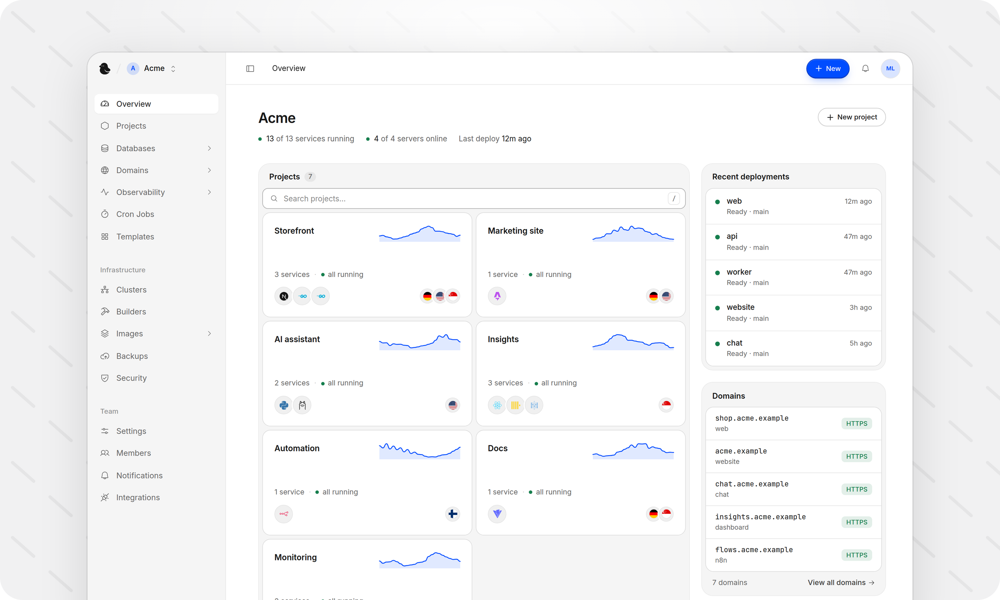

<div align="center">


# Pyo

**The open-source, self-hosted PaaS alternative to Vercel, Netlify, Railway, Render and Fly.io.**

Deploy your code, databases and ready-made templates on your own servers.
Manage everything from the dashboard or the CLI, on one machine or a whole
cluster.

</div>

<picture>
  <source media="(prefers-color-scheme: dark)" srcset="./docs/assets/dashboard-dark.png" />
  <source media="(prefers-color-scheme: light)" srcset="./docs/assets/dashboard-light.png" />
  
</picture>

## Why Pyo

Pyo gives you the experience of a modern cloud platform on hardware you
already own or rent: a VPS, a dedicated server, or the machine under your desk.
Pick a Git repository, an image or a template, and Pyo builds it, runs it
and puts it on the web with HTTPS.

Start with one machine, then add servers, build machines and teammates as you
grow. Pyo runs on k3s, but you never have to touch Kubernetes. Your services
keep running if Pyo itself is down, and everything it deploys is standard
Kubernetes, so you're never locked in.

## Features

- **Deploy anything:** build with your Dockerfile or Containerfile, or with
  zero configuration, or run any container image.
- **Databases:** Postgres, MySQL and KV (Redis-compatible), with
  automatic failover, backups with point-in-time recovery (for MySQL, up to
  its latest backup), and read replicas for Postgres and KV. Import an
  existing database from a URL or a dump file.
- **Templates:** WordPress, Ghost, MongoDB, ClickHouse, n8n, Ollama and more,
  in one click.
- **Volumes:** back them up, restore them, resize them and move them between
  projects.
- **Deploy on every push:** connect GitHub and roll back in one click. A failed
  deploy puts the previous version back on its own.
- **Domains and HTTPS:** automatic Let's Encrypt certificates, or start with a
  free domain that needs no DNS setup.
- **Grow across servers:** add machines over Tailscale and choose where each
  service runs.
- **See what's happening:** analytics, live logs, CPU and memory charts, and a
  terminal into any service.
- **Keep it safe:** encrypted secrets, imports from secret managers like Vault
  and AWS, access rules and a web application firewall for each service,
  scheduled backups to a built-in store or your own bucket, and isolated
  project networks.
- **Work your way:** the dashboard, the `pyo` CLI, an API, or MCP for AI
  assistants like Claude and Cursor.

## Ready for production

Pyo runs your services on [k3s](https://k3s.io), a lightweight, certified
Kubernetes distribution, so they get the same foundation used by large
production systems:

- **Deploys without downtime:** the new version has to be ready before the old
  one stops. Services with a single-writer volume restart instead, to protect
  their data.
- **Self-healing:** crashed containers restart on their own, and stateless
  services move to a healthy server if one goes down.
- **Room to scale:** run several replicas of a service across your servers, or
  let Pyo add and remove them as CPU use changes.
- **Databases that fail over:** a database can keep replicas on other
  servers, and one takes over when the primary's server is lost.
- **Isolation by default:** project networks are kept apart, and secrets are
  encrypted at rest.

## Requirements

Pyo runs on a laptop, a desktop, a spare machine at home, a VPS or a dedicated
server. It needs:

- **System:** Linux on x86-64, with root or `sudo` access.
- **Resources:** at least 2 CPU cores, 2 GB of memory and 40 GB of disk.
- **Memory:** 2 GB is the minimum, enough to try Pyo or run a few small
  services. 4 GB is recommended for real use with databases. Choose 8 GB or
  more for many services, builds on the same server and several databases. A
  build server or more servers in the cluster spread the load.
- **Ports:** 80, 443 and 8000 reachable, with 5005 and 6443 free.

Let's Encrypt certificates need a machine that's reachable from the internet.
Free domains on a Tailscale address get a self-signed certificate instead.

## Getting started

Run this on your machine:

```bash
curl -fsSL https://pyo.dev/install.sh | bash
```

It installs k3s (unless it's there) and the latest Pyo release. When it
finishes, it prints your dashboard address (on each of the machine's addresses,
its Tailscale name included) and a one-time login. Sign in and choose your own
email and password. The dashboard then walks you through connecting this
machine and deploying your first service.

## Updating

Update from the dashboard under **Settings › Updates**, or run the install
command again: it updates to the latest release, keeping all your data. For a
particular release:

```bash
curl -fsSL https://pyo.dev/install.sh | bash -s -- --version 0.1.0
```

A release with notices asks before it updates. Add `--yes` once you've read
them (for example in scripts).

## Deploy from your terminal

Install the `pyo` CLI from your own Pyo (put its address in place of
`your-pyo`):

```bash
curl -fsSL https://your-pyo/install/cli.sh | sh
pyo login     # approve in your browser
pyo link      # choose the service this folder deploys
pyo deploy    # deploy and follow it live
```

Run `pyo --help` for logs, environment variables, rollbacks and more.

## Uninstalling

To remove Pyo from the machine you installed it on:

```bash
curl -fsSL https://pyo.dev/install.sh | bash -s -- --uninstall
```

It keeps your volumes' data unless you add `--purge`. Back up first: see
[Uninstalling Pyo](https://pyo.dev/docs/uninstall).

Building from source or contributing? See [CONTRIBUTING.md](CONTRIBUTING.md).

## Projects

- [pyo-docs](https://github.com/upsetdev/pyo-docs): the documentation, published at [pyo.dev/docs](https://pyo.dev/docs).
- [pyo-web](https://github.com/upsetdev/pyo-web): the website, [pyo.dev](https://pyo.dev).
- [pyo-templates](https://github.com/upsetdev/pyo-templates): the one-click templates.

## License

Pyo is open source under the [Apache License 2.0](./LICENSE).
